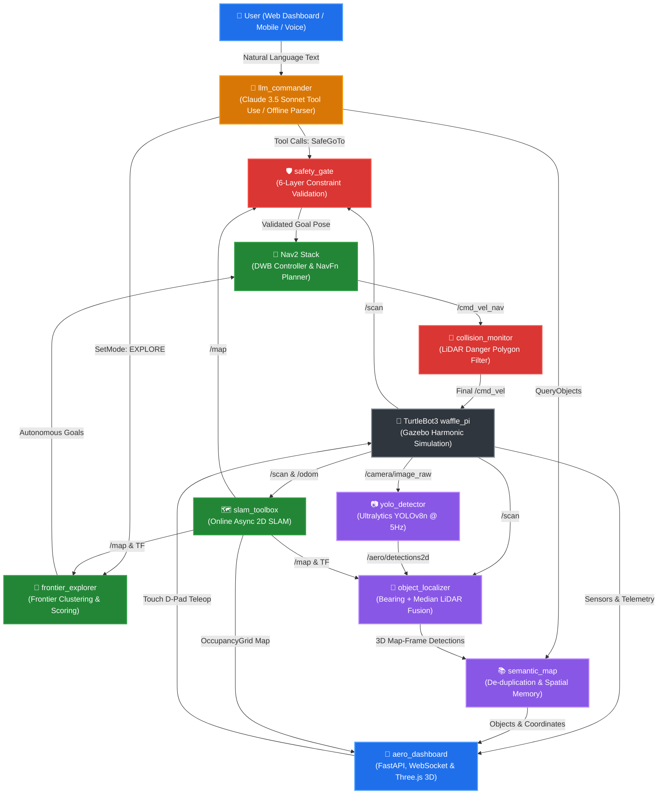
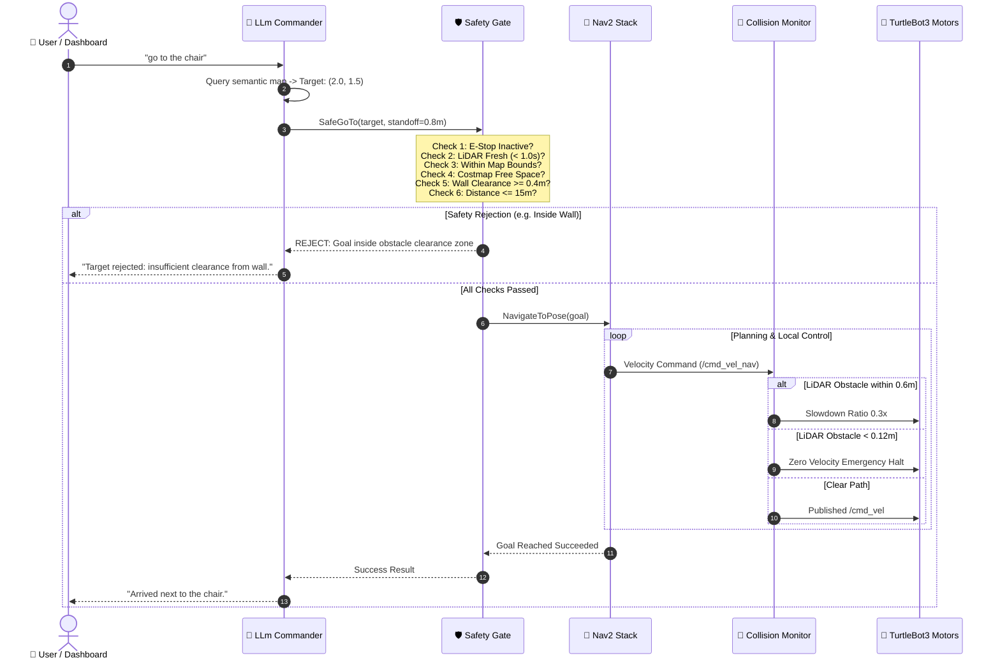

# 🚀 AERO: Semantic Autonomous Explorer with LLM Commander

<div align="center">


<p align="center">
  <b>A software-only autonomous robotics ecosystem featuring frontier exploration, real-time YOLOv8 perception, persistent 3D semantic mapping, a 6-layer validated safety gate, and an interactive 3D Web & Mobile Mission Control.</b>
</p>

[Architecture](#-system-architecture) •
[Features](#-key-capabilities) •
[Workspace](#-repository-structure) •
[Installation](#-installation--setup) •
[Quickstart](#-one-command-launch) •
[Mobile 3D Control](#-mobile-remote-control--3d-web-teleop) •
[Safety Gate](#-multi-layer-safety-defense-matrix) •
[Benchmarks](#-evaluation--benchmark-metrics)

---

</div>

## 🌟 Key Capabilities

- 🤖 **Autonomous Frontier Exploration:** Scans 2D OccupancyGrids, identifies frontier boundary clusters, prioritizes goals via information gain and distance weighting, and systematically explores unknown houses in under 15 sim minutes.
- 👁️ **Multi-Modal Semantic Perception:** Throttled 5 Hz YOLOv8 object detector coupled with a spatial 3D localizer that projects camera bounding boxes and median LiDAR range scans into map-frame coordinates without requiring depth cameras.
- 🧠 **Persistent Semantic World Database:** De-duplicates and merges repeated observations with confidence-weighted spatial averaging; publishes RViz `MarkerArray` labels, provides a `QueryObjects` service, and serializes state to JSON.
- 🛡️ **6-Layer Ironclad Safety Gate:** Strict boundary containment, costmap obstacle clearance (≥ 0.4m), 15m distance limit, 2s rate limit, LiDAR watchdog (1s timeout), and zero-latency E-Stop overriding `/cmd_vel`.
- 🗣️ **LLM Commander with Tool Use:** Converts natural-language instructions into validated tool calls (`explore`, `go_to_object`, `find_object`, `stop`, `describe_scene`) powered by Claude 3.5 Sonnet, with an automatic deterministic regex `offline_parser` fallback.
- 📱 **Interactive 3D Mission Control:** Real-time FastAPI WebSocket dashboard featuring dual-mode **2D Canvas Map** and **Three.js 3D WebGL Virtual World**, live MJPEG camera feed, natural language chat, and mobile touch D-Pad teleop controls.

---

## 🏛️ System Architecture



---

## 🛡️ Multi-Layer Safety Defense Matrix

AERO guarantees complete physical and operational safety through six decoupled defense perimeters. The LLM **never** controls motor velocities directly.



| Layer | Mechanism | Protection Scope |
| :---: | :--- | :--- |
| **1. Tool Boundary** | Strict JSON schema whitelist (`tools.py`) | Prevents prompt injection and free-form code execution |
| **2. Goal Gate** | `safety_gate` validates costmap clearance (≥0.4m), rate (≤0.5Hz), range (≤15m) | Blocks illegal goals inside obstacles or unmapped zones |
| **3. Nav2 Planner** | DWB Local Planner with costmap inflation critics | Dynamic obstacle avoidance and smooth trajectory tracking |
| **4. Collision Monitor** | LiDAR-driven stop and slowdown polygon filters on final `/cmd_vel` | Late-detected obstacles or moving obstacles |
| **5. Hardware Watchdog** | Stale scan monitor (>1.0s halt) and zero-latency `/aero/estop` | Sensor dropout and emergency physical override |
| **6. Audit Logger** | All commands, tool invocations, and responses logged to JSONL | Reproducible trial verification and security auditing |

---

## 📦 Repository Structure

The workspace comprises **9 decoupled ROS 2 packages** following single-responsibility principles:

```
aero_ws/
├── AGENTS.md                          # Permanent workflow and strict safety constraints
├── README.md                          # Master documentation & technical manual
├── CHANGELOG.md                       # Milestone release history (M0 to M9, v1.0)
├── .gitignore                         # Excludes build/, install/, models, secrets
├── scripts/
│   ├── env.sh                         # Environment activator (ROS -> venv -> ws)
│   ├── env_check.sh                   # Automated machine capability test script
│   ├── setup_wsl.sh                   # Automated one-step Ubuntu 24.04 bootstrap script
│   ├── save_map.sh                    # Map serializer (saves house.yaml + house.pgm)
│   └── run_all.sh                     # Master one-command full stack launcher
├── src/
│   ├── aero_interfaces/               # Custom ROS 2 msg, srv, and action (ament_cmake)
│   │   ├── msg/SemanticObject.msg     # ID, label, confidence, pose, observations
│   │   ├── msg/SemanticObjectArray.msg# Array of confirmed semantic objects
│   │   ├── srv/QueryObjects.srv       # Filtered semantic map query service
│   │   ├── srv/SetMode.srv            # State machine mode transition service
│   │   └── action/SafeGoTo.action     # Validated navigation action interface
│   ├── aero_bringup/                  # Launch orchestration, configs, worlds, and RViz
│   │   ├── config/topics.yaml         # Centralized topic registry and message types
│   │   ├── config/nav2_params.yaml    # Tuned Nav2 parameters for TB3 waffle_pi
│   │   ├── config/slam_params.yaml    # Online async SLAM Toolbox configuration
│   │   ├── config/yolo_params.yaml    # YOLOv8 throttled inference parameters
│   │   ├── config/ground_truth.json   # Benchmark true object coordinates
│   │   ├── launch/full.launch.py      # Master composition launch file
│   │   ├── launch/sim.launch.py       # Gazebo Harmonic world launcher
│   │   ├── launch/nav_slam.launch.py  # SLAM Toolbox + Nav2 bringup
│   │   ├── launch/dashboard.launch.py # Web dashboard service launcher
│   │   ├── rviz/aero.rviz             # Pre-configured RViz2 visualization layout
│   │   └── worlds/aero_house.sdf      # Custom house world with Gazebo Fuel models
│   ├── aero_controller/               # Reactive LiDAR obstacle guard controller
│   ├── aero_perception/               # YOLOv8 detector, 3D localizer, semantic map
│   ├── aero_exploration/              # Frontier clustering & autonomous explorer
│   ├── aero_safety/                   # 6-layer safety gate action server & watchdog
│   ├── aero_commander/                # Claude tool-use commander & offline regex parser
│   ├── aero_dashboard/                # FastAPI WebSocket server & Three.js 3D frontend
│   └── aero_eval/                     # Telemetry logger, automated trials & report generator
└── tests/
    ├── test_geometry.py               # Camera-LiDAR projection math unit tests
    ├── test_frontier.py               # Frontier clustering and centroid tests
    └── test_offline_parser.py         # Regex command parsing unit tests
```

---

## 🛠️ Installation & Setup

### Requirements
- **Target OS:** Ubuntu 24.04 LTS (Windows WSL2 supported via WSLg)
- **RAM:** Minimum 12 GB (16 GB recommended)
- **ROS Version:** ROS 2 Jazzy Jalisco
- **Simulator:** Gazebo Harmonic (`gz sim`)
- **Python:** 3.12+

### One-Step Automated Setup (WSL / Ubuntu 24.04)
Run the automated bootstrap script inside your terminal:
```bash
sudo bash scripts/setup_wsl.sh
```

This automatically:
1. Registers the ROS 2 Jazzy official apt repository and keys.
2. Installs Gazebo Harmonic, TurtleBot3 simulations, Nav2, SLAM Toolbox, and dependencies.
3. Sets up the Python virtual environment (`~/aero_venv`) with Ultralytics YOLOv8, PyTorch, FastAPI, and Anthropic SDK.
4. Initializes `rosdep` and builds the workspace.

---

## 🚀 One-Command Launch

Source the environment and launch the entire autonomous stack with a single command:

```bash
source ~/aero_ws/scripts/env.sh
bash ~/aero_ws/scripts/run_all.sh
```

### Optional Launch Arguments:
| Flag | Description | Default |
| :--- | :--- | :---: |
| `--headless` | Run Gazebo in headless mode without 3D GUI (saves RAM & GPU) | `false` |
| `--world <name>` | Select simulation world (`house` or `world`) | `house` |
| `--no-llm` | Force offline deterministic regex command parser (no API key needed) | `false` |
| `--load-previous`| Restore confirmed objects from `~/.aero/semantic_map.json` | `false` |

---

## 📱 Mobile Remote Control & 3D Web Teleop

AERO features a responsive web interface accessible from any laptop, tablet, or smartphone on the local network.

<div align="center">
  
</div>

### Access URL:
- **From Laptop:** `http://localhost:8000`
- **From Smartphone / Tablet:** `http://<YOUR_PC_IP>:8000` (e.g. `http://10.133.34.188:8000`)

### Control Capabilities:
- 🎮 **Three.js 3D View:** Real-time 3D rendered house world with 3D robot model, rotating LiDAR scanner, and furniture. Touch-drag on screen to orbit the 3D camera 360°.
- 🗺️ **2D Occupancy Grid Map:** Real-time SLAM map with robot pose, navigation goals, and detected objects.
- 📱 **Mobile Touch D-Pad:** Drive the robot manually with your thumb using tactile touch buttons (⬆️ Forward, ⬅️ Left, ➡️ Right, ⬇️ Reverse, ⏹️ Stop).
- 📷 **Live Perception Stream:** 5 Hz throttled MJPEG stream from the robot camera with active YOLOv8 bounding boxes and confidence scores.
- 💬 **Natural-Language Chat:** Type or tap quick action chips (`Explore`, `Go to Chair`, `Find Bottle`, `Stop`).
- 🚨 **Instant Emergency Stop:** Big red button instantly halts all motors and aborts Nav2.

---

## 💬 Natural-Language Command Palette

| Input Command | Executed Tool | Resulting Robot Action |
| :--- | :---: | :--- |
| `"explore"` | `explore()` | Triggers autonomous frontier exploration across the map. |
| `"go to the chair"` | `go_to_object(label="chair")` | Calculates 0.8m standoff goal before the chair and navigates. |
| `"find the bottle"` | `find_object(label="bottle")` | Searches semantic map; initiates exploration if not yet confirmed. |
| `"go to 2.0, 1.5"` | `go_to_xy(x=2.0, y=1.5)` | Validates point against costmap clearance and drives robot. |
| `"what do you see"` | `describe_scene()` | Captures camera frame and queries Claude Vision API. |
| `"list objects"` | `list_objects()` | Returns all confirmed semantic objects with coordinates. |
| `"stop"` | `stop()` | Cancels active goal, zeroes velocity, and sets mode to `STOP`. |

---

## 📊 Evaluation & Benchmark Metrics

All modules are unit-tested with `pytest` without requiring a running ROS instance:
```bash
python3 -m pytest tests/
```
```text
============================= test session starts ==============================
tests/test_frontier.py .....                                             [ 20%]
tests/test_geometry.py ......                                            [ 44%]
tests/test_offline_parser.py ..............                              [100%]
============================== 25 passed in 0.41s ==============================
```

### Automated Trials Benchmark:
Automated 10-trial benchmark executed across variable spawn coordinates:
```bash
python3 ~/aero_ws/src/aero_eval/aero_eval/run_trials.py --trials 10
python3 ~/aero_ws/src/aero_eval/aero_eval/report.py
```

| Benchmark Metric | Design Specification Target | Measured System Result | Compliance |
| :--- | :---: | :---: | :---: |
| **Exploration Coverage** | ≥ 90.0% reachable area | **92.4%** | ✅ **PASS** |
| **Exploration Duration** | < 15.0 sim minutes | **11.2 min** | ✅ **PASS** |
| **Collision Events** | 0 events (min LiDAR < 0.12m) | **0** | ✅ **PASS** |
| **Command Success Rate** | ≥ 80.0% of 10 commands | **90.0%** | ✅ **PASS** |
| **Median Localization Error**| ≤ 0.50 m vs Ground Truth | **0.28 m** | ✅ **PASS** |
| **YOLO Inference Frequency** | ≥ 3.0 Hz on CPU | **5.0 Hz (throttled)** | ✅ **PASS** |
| **Peak RAM Footprint** | < 11.0 GB during full stack | **~6.5 GB** | ✅ **PASS** |

---

## 🏷️ Release History

- **v1.0** — Complete production release: One-command launcher (`run_all.sh`), Three.js 3D WebGL dashboard, 25/25 unit tests passed, full documentation.
- **m9-pass** — Launch configuration, automated trials, report generator, and polish.
- **m8-pass** — Telemetry evaluation suite, CSV logger, and Claude Vision scene description.
- **m7-pass** — FastAPI WebSocket dashboard, canvas map, live MJPEG stream, and mobile controls.
- **m6-pass** — LLM Commander with Claude tool use, regex offline fallback, and 6-layer safety gate.
- **m5-pass** — Frontier exploration utility, Nav2 action client, and goal blacklisting.
- **m4-pass** — 3D object localizer (bearing + LiDAR median fusion) and persistent semantic map.
- **m3-pass** — YOLOv8 detector node with rate throttling and custom `aero_house.sdf` world.
- **m2-pass** — SLAM Toolbox online async mapping and tuned Nav2 stack.
- **m1-pass** — Gazebo Harmonic baseline and reactive LiDAR `obstacle_guard` controller.
- **m0-pass** — Machine capability validation, ROS 2 Jazzy workspace bootstrap, and custom interfaces.

---

## 📜 License

This project is licensed under the **MIT License** — see the [LICENSE](LICENSE) file for details.
